# BugiStore 🎮

EDICION PARA PRUEBA

Sistema web de gestión y venta de videojuegos desarrollado mediante una arquitectura de microservicios. El proyecto integra autenticación, gestión de usuarios, catálogo de videojuegos, compras, control de inventario, panel administrativo, Progressive Web App (PWA), contenedorización con Docker e integración y entrega continua (CI/CD) mediante GitHub Actions y Jenkins.

---

# 1. Descripción del proyecto

BugiStore es una plataforma web orientada a la venta y administración de videojuegos.

El sistema fue desarrollado utilizando una arquitectura de microservicios, donde cada servicio posee una responsabilidad específica y administra su propia base de datos.

La comunicación entre los servicios se realiza mediante APIs HTTP y las solicitudes externas son centralizadas mediante un API Gateway.

El proyecto también incorpora:

- Contenedorización de los servicios mediante Docker.
- Orquestación de contenedores mediante Docker Compose.
- Publicación de imágenes en Docker Hub.
- Integración continua mediante GitHub Actions.
- Automatización de construcción y publicación mediante Jenkins.
- Progressive Web App (PWA) con almacenamiento de recursos estáticos mediante Service Worker.

---

# 2. Objetivos

## Objetivo general

Desarrollar una plataforma web para la gestión y venta de videojuegos utilizando una arquitectura de microservicios que permita separar responsabilidades, facilitar el mantenimiento y mejorar la escalabilidad del sistema.

## Objetivos específicos

- Implementar autenticación y autorización de usuarios.
- Gestionar usuarios y roles.
- Administrar un catálogo de videojuegos.
- Implementar control de inventario.
- Permitir la realización de compras.
- Registrar y consultar compras realizadas.
- Implementar funciones administrativas.
- Centralizar las solicitudes mediante un API Gateway.
- Separar la información mediante bases de datos independientes.
- Implementar pruebas funcionales de los servicios.
- Configurar integración continua mediante GitHub Actions.
- Automatizar la construcción y publicación de imágenes Docker.
- Implementar un pipeline CI/CD mediante Jenkins.
- Convertir el frontend en una Progressive Web App.

---

# 3. Alcance

El sistema permite:

- Registrar usuarios.
- Iniciar y cerrar sesión.
- Validar sesiones mediante tokens.
- Manejar roles de usuario y administrador.
- Consultar videojuegos.
- Consultar información individual de videojuegos.
- Crear, modificar y eliminar videojuegos mediante funciones administrativas.
- Controlar el stock disponible.
- Realizar compras.
- Consultar las compras del usuario.
- Consultar todas las compras mediante el panel administrativo.
- Administrar usuarios.
- Eliminar usuarios.
- Instalar BugiStore como aplicación PWA.
- Utilizar recursos estáticos previamente almacenados mediante caché.
- Ejecutar los servicios mediante contenedores Docker.
- Automatizar procesos de construcción y publicación mediante CI/CD.

Las operaciones que requieren comunicación con los microservicios necesitan conexión al backend y a sus respectivas bases de datos.

---

# 4. Tecnologías utilizadas

## Frontend

- HTML5
- CSS3
- JavaScript
- Progressive Web App (PWA)
- Web App Manifest
- Service Worker
- Nginx

## Backend

- PHP 7.3
- APIs HTTP
- Arquitectura de microservicios
- Apache
- PDO
- MySQLi

## Bases de datos

- MySQL 8.0
- phpMyAdmin

## Contenedorización

- Docker
- Docker Compose
- Docker Hub
- Docker Desktop
- Nginx Alpine
- PHP Apache

## Integración y entrega continua

- GitHub Actions
- Jenkins
- Jenkins Pipeline
- Docker Build
- Publicación automática de imágenes Docker

## Control de versiones

- Git
- GitHub

## Entorno de desarrollo

- Windows
- AppServ
- Apache
- PHP
- MySQL
- PowerShell

---

# 5. Arquitectura del sistema

El proyecto utiliza una arquitectura de microservicios.

```text
                         ┌──────────────────────┐
                         │       Frontend       │
                         │   HTML / CSS / JS    │
                         │         PWA          │
                         └──────────┬───────────┘
                                    │
                                    ▼
                         ┌──────────────────────┐
                         │     API Gateway      │
                         └──────────┬───────────┘
                                    │
              ┌─────────────────────┼─────────────────────┐
              │                     │                     │
              ▼                     ▼                     ▼
     ┌────────────────┐    ┌────────────────┐    ┌────────────────┐
     │  Auth Service  │    │  User Service  │    │  Game Service  │
     └───────┬────────┘    └───────┬────────┘    └───────┬────────┘
             │                     │                     │
             ▼                     ▼                     ▼
     ┌────────────────┐    ┌────────────────┐    ┌────────────────┐
     │  tienda_auth  │    │  tienda_users  │    │  tienda_games  │
     └────────────────┘    └────────────────┘    └────────────────┘

                                    │
                                    ▼
                         ┌──────────────────────┐
                         │   Purchase Service   │
                         └──────────┬───────────┘
                                    │
                                    ▼
                         ┌──────────────────────┐
                         │  tienda_purchases    │
                         └──────────────────────┘
```

Cada microservicio se encarga de una responsabilidad específica y mantiene su propia base de datos.

La comunicación entre los servicios se realiza mediante solicitudes HTTP. Las operaciones internas sensibles utilizan un mecanismo de autenticación mediante un secreto compartido configurado en variables de entorno.

---

# 6. Estructura del proyecto

```text
-gestion-desarrollo-software-equipo01/
│
├── .github/
│   └── workflows/
│       └── ci.yml
│
├── api-gateway/
│   └── public/
│       └── index.php
│
├── auth-service/
│   ├── config/
│   ├── controllers/
│   ├── middleware/
│   ├── models/
│   ├── public/
│   └── services/
│
├── database/
│   ├── 01-tienda-auth.sql
│   ├── 02-tienda-users.sql
│   ├── 03-tienda-games.sql
│   └── 04-tienda-purchases.sql
│
├── docker/
│   ├── php-service.Dockerfile
│   ├── frontend.Dockerfile
│   └── nginx.conf
│
├── frontend/
│   ├── index.html
│   ├── login.html
│   ├── registro.html
│   ├── tienda.html
│   ├── admin.html
│   ├── manifest.json
│   ├── service-worker.js
│   │
│   ├── css/
│   │   └── styles.css
│   │
│   ├── js/
│   │   ├── auth.js
│   │   ├── tienda.js
│   │   ├── admin.js
│   │   └── pwa.js
│   │
│   └── images/
│       ├── games/
│       ├── icons/
│       └── README/
│
├── game-service/
│   ├── config/
│   ├── controllers/
│   ├── middleware/
│   ├── models/
│   ├── public/
│   └── services/
│
├── purchase-service/
│   ├── config/
│   ├── controllers/
│   ├── middleware/
│   ├── models/
│   ├── public/
│   └── services/
│
├── user-service/
│   ├── config/
│   ├── controllers/
│   ├── middleware/
│   ├── models/
│   ├── public/
│   └── services/
│
├── .env.example
├── .gitignore
├── docker-compose.yml
├── Jenkinsfile
└── README.md
```

---

# 7. Microservicios

## 7.1 Auth Service

Responsable de la autenticación y autorización.

Funciones principales:

- Registro de usuarios.
- Inicio de sesión.
- Validación de tokens.
- Cierre de sesión.
- Expiración de tokens.
- Manejo de roles.
- Comunicación interna con User Service.

El sistema utiliza tokens Bearer para autenticar las solicitudes protegidas.

El token debe enviarse mediante el encabezado:

```http
Authorization: Bearer TOKEN
```

## 7.2 User Service

Responsable de la gestión de usuarios.

Funciones:

- Listar usuarios.
- Consultar usuarios.
- Actualizar información.
- Eliminar usuarios.
- Sincronizar información con Auth Service.
- Validar permisos administrativos.

Las operaciones administrativas requieren autenticación y autorización.

## 7.3 Game Service

Responsable del catálogo de videojuegos.

Funciones:

- Consultar todos los videojuegos.
- Consultar un videojuego.
- Crear videojuegos.
- Actualizar videojuegos.
- Eliminar videojuegos.
- Consultar y controlar stock.
- Disminuir stock durante una compra.

Las operaciones de modificación están protegidas para usuarios administradores.

## 7.4 Purchase Service

Responsable de las compras.

Funciones:

- Crear compras.
- Validar usuario autenticado.
- Validar existencia del videojuego.
- Validar disponibilidad de stock.
- Disminuir el inventario.
- Registrar la compra.
- Consultar compras del usuario.
- Consultar todas las compras para administradores.

Durante una compra se realiza una comunicación entre Purchase Service y Game Service para validar y disminuir el inventario.

---

# 8. API Gateway

El API Gateway funciona como punto de entrada principal para las solicitudes del frontend.

Permite centralizar las peticiones hacia los diferentes microservicios.

Las principales acciones son:

```text
?action=auth
?action=users
?action=games
?action=purchases
```

Para autenticación se utilizan operaciones específicas:

```text
?action=auth&auth_action=login
?action=auth&auth_action=register
```

Para videojuegos:

```text
?action=games&game_action=all
```

Para compras se manejan operaciones como:

```text
purchase_action=create
purchase_action=my-purchases
purchase_action=all
```

El Gateway también se encarga de recibir y reenviar los encabezados de autorización correspondientes.

---

# 9. Bases de datos

Cada microservicio utiliza una base de datos independiente.

```text
tienda_auth
tienda_users
tienda_games
tienda_purchases
```

Esta separación permite mantener aislada la información correspondiente a cada dominio del sistema.

### tienda_auth

Contiene la información necesaria para autenticación y credenciales.

### tienda_users

Contiene la información de los usuarios.

### tienda_games

Contiene el catálogo y stock de videojuegos.

### tienda_purchases

Contiene los registros de compras.

Los archivos SQL de inicialización se encuentran en el directorio `database/`.

---

# 10. Frontend

El frontend está desarrollado con HTML5, CSS3 y JavaScript.

El diseño utiliza una identidad visual gaming de estilo Cyberpunk, con elementos visuales modernos, gradientes, efectos de iluminación, tarjetas y componentes adaptados a la temática de videojuegos.

Las principales páginas son:

```text
index.html
login.html
registro.html
tienda.html
admin.html
```

### Página principal

Presenta la plataforma y permite acceder a las funciones principales.

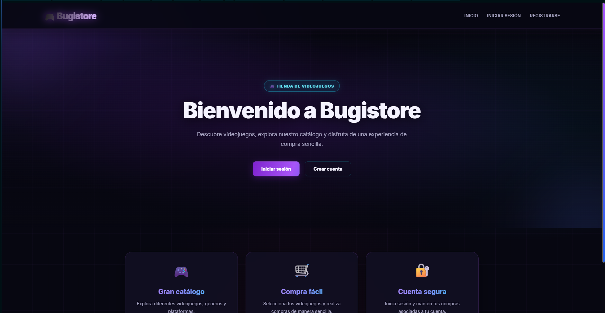

### Login

Permite iniciar sesión mediante las credenciales registradas.

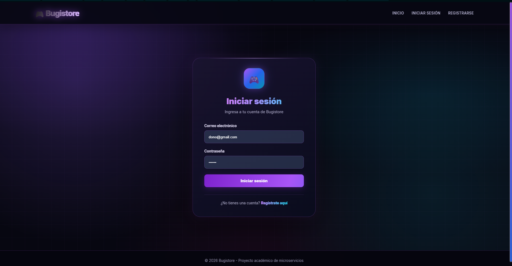

### Registro

Permite crear una nueva cuenta.

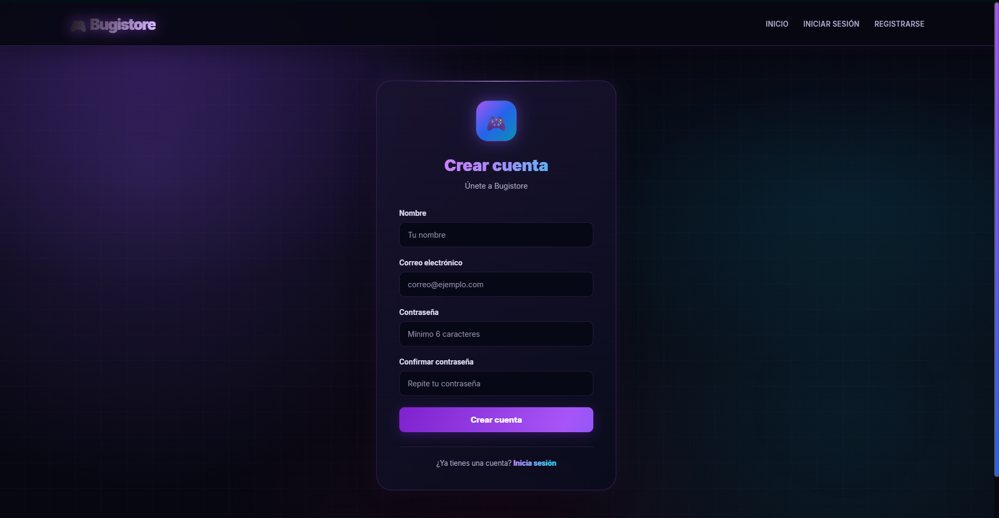

### Tienda

Presenta el catálogo de videojuegos y permite realizar compras.

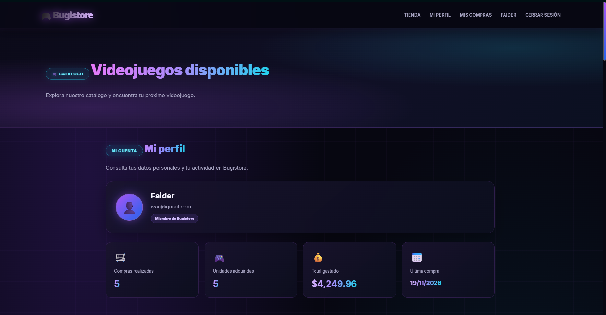
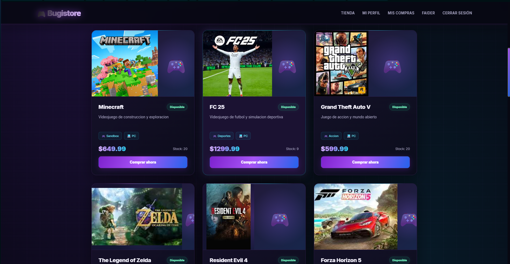
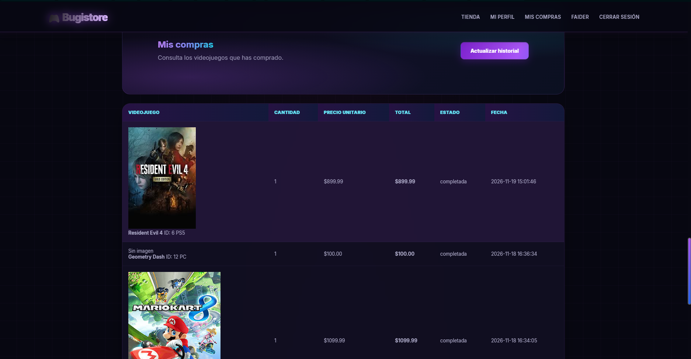

### Administración

Permite a los usuarios administradores gestionar videojuegos, usuarios y compras.

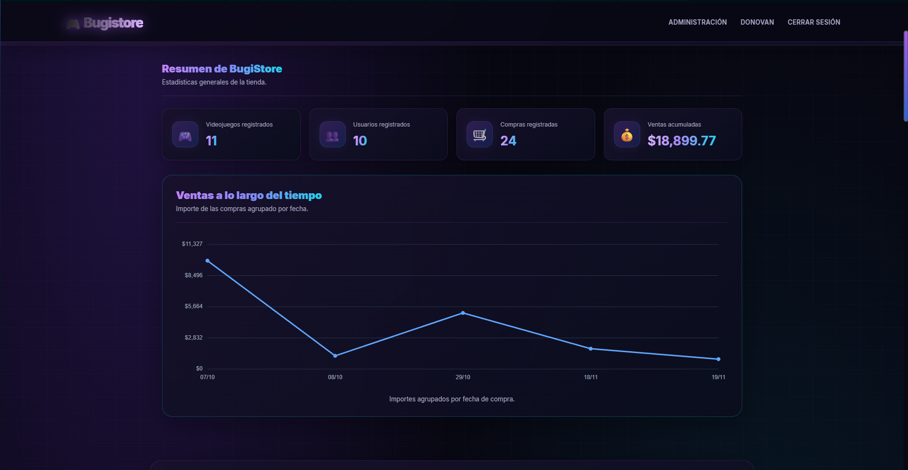
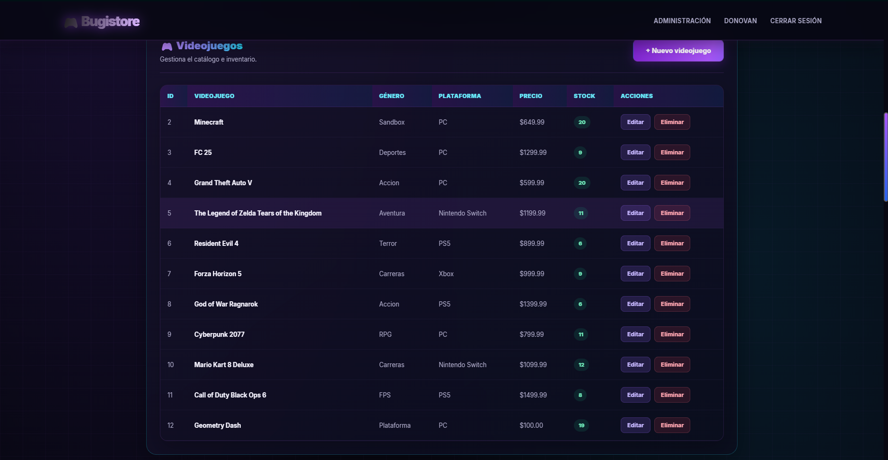
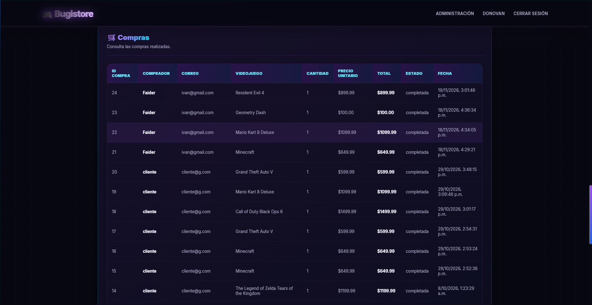
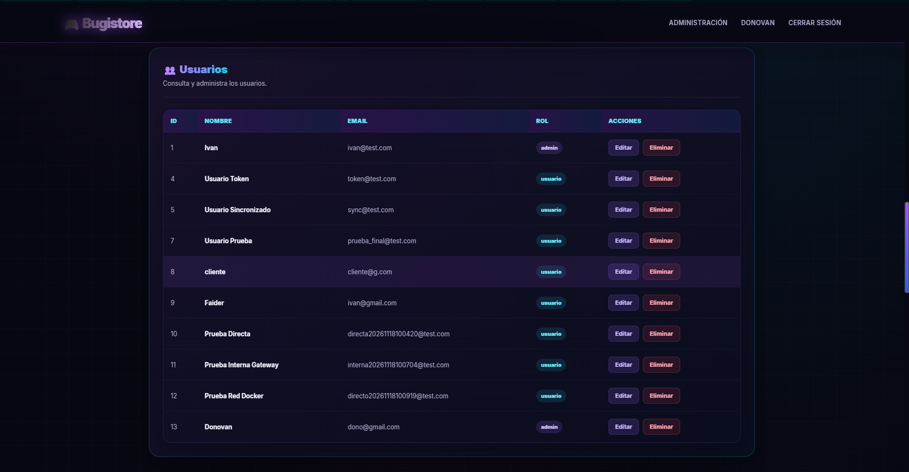

El frontend mantiene separada su presentación visual de la lógica funcional de autenticación, compras y administración.

---

# 11. Progressive Web App (PWA)

BugiStore fue convertida en una Progressive Web App.

La implementación PWA permite instalar la plataforma como aplicación y almacenar recursos estáticos para mejorar su disponibilidad.

La PWA utiliza:

```text
manifest.json
service-worker.js
js/pwa.js
images/icons/icon-192.png
images/icons/icon-512.png
```

## Manifest

El archivo `manifest.json` define la información principal de la aplicación:

- Nombre: BugiStore.
- Nombre corto: Bugistore.
- Modo de visualización: standalone.
- Orientación: portrait-primary.
- Color de fondo y tema.
- Iconos de instalación.

## Service Worker

El Service Worker permite almacenar recursos estáticos de BugiStore en caché.

Se almacenan principalmente:

- Archivos HTML.
- CSS.
- JavaScript.
- Manifest.
- Iconos.
- Imágenes.
- Otros recursos estáticos compatibles.

Las peticiones a los microservicios no son almacenadas por el Service Worker.

Esto evita utilizar respuestas antiguas para operaciones como autenticación, compras y administración.

## Estrategia de caché

La implementación utiliza una estrategia Cache First para los recursos compatibles.

Esto significa que el navegador consulta primero la caché y, cuando un recurso no está almacenado, lo solicita al servidor.

Para mantener actualizados los recursos, el Service Worker utiliza un identificador de versión:

```javascript
const CACHE_NAME = "bugistore-v2";
```

Cuando se publica una nueva versión, el evento `activate` elimina las cachés anteriores y permite que los clientes utilicen la nueva versión.

## Funcionamiento offline

La aplicación puede recuperar recursos previamente almacenados aunque no exista conexión.

Sin embargo, las operaciones que requieren comunicación con los microservicios necesitan conexión:

```text
Login                  → Requiere backend
Registro               → Requiere backend
Carga del catálogo     → Requiere backend
Compra                 → Requiere backend
Administración         → Requiere backend
Recursos estáticos     → Pueden estar disponibles offline
```

La implementación offline está enfocada en la disponibilidad de los recursos estáticos previamente almacenados.

## Iconos

La PWA utiliza:

```text
icon-192.png
icon-512.png
```

Con dimensiones:

```text
192 × 192 px
512 × 512 px
```

---

# 12. Seguridad

El sistema implementa diferentes mecanismos de seguridad:

- Autenticación mediante tokens.
- Autorización mediante roles.
- Middleware para validar tokens.
- Middleware para validar administradores.
- Protección de endpoints administrativos.
- Validación de existencia de usuarios.
- Validación de videojuegos.
- Validación de stock.
- Control de acceso a las compras.
- Comunicación controlada entre microservicios.
- Uso de variables de entorno para configurar credenciales y secretos.

## Comunicación interna

Las comunicaciones internas sensibles entre servicios utilizan un secreto compartido configurado mediante la variable de entorno:

```text
INTERNAL_API_SECRET
```

Las solicitudes internas correspondientes envían el encabezado:

```http
X-Internal-Secret: SECRET
```

Este mecanismo permite proteger operaciones internas, como la sincronización de usuarios y la disminución de inventario.

Las credenciales y secretos no deben almacenarse directamente dentro del código fuente ni publicarse en el repositorio.

---

# 13. Flujo de autenticación

El proceso general de autenticación es:

```text
Usuario
   │
   ▼
Frontend
   │
   ▼
API Gateway
   │
   ▼
Auth Service
   │
   ▼
Validación de credenciales
   │
   ▼
Generación de token
   │
   ▼
Frontend
```

Posteriormente el frontend utiliza el token para realizar solicitudes protegidas.

---

# 14. Flujo de compra

El flujo de compra es:

```text
Usuario
   │
   ▼
Frontend
   │
   ▼
API Gateway
   │
   ▼
Purchase Service
   │
   ├──► Auth Service
   │       └── Validación del usuario
   │
   └──► Game Service
           ├── Validar videojuego
           ├── Validar stock
           └── Disminuir stock
                    │
                    ▼
             Purchase Service
                    │
                    ▼
             Registrar compra
```

Este flujo permite mantener separadas las responsabilidades de cada servicio.

---

# 15. Funciones administrativas

Los usuarios con rol de administrador pueden acceder a funciones adicionales.

Entre ellas:

- Crear videojuegos.
- Modificar videojuegos.
- Eliminar videojuegos.
- Consultar usuarios.
- Actualizar usuarios.
- Eliminar usuarios.
- Consultar todas las compras.

Las operaciones administrativas están protegidas mediante autenticación y autorización.

---

# 16. Pruebas realizadas

Se realizaron pruebas funcionales sobre los diferentes componentes del sistema.

## Auth Service

- Registro.
- Login.
- Validación.
- Logout.
- Expiración de tokens.
- Roles.
- Eliminación de usuarios.
- Sincronización con User Service.

## User Service

- Consulta de usuarios.
- Actualización.
- Eliminación.
- Protección administrativa.
- Sincronización con Auth Service.

## Game Service

- Consulta del catálogo.
- Consulta individual.
- Creación.
- Actualización.
- Eliminación.
- Control de stock.
- Disminución de stock durante compras.

## Purchase Service

- Creación de compras.
- Validación de usuario.
- Validación de videojuegos.
- Validación de stock.
- Registro de compras.
- Consulta de compras personales.
- Consulta administrativa.

## Frontend

- Registro.
- Login.
- Navegación.
- Catálogo.
- Compra.
- Panel administrativo.
- Gestión de usuarios.
- Gestión de videojuegos.

## PWA

- Registro del Service Worker.
- Reconocimiento del Manifest.
- Validación de iconos.
- Instalación como aplicación.
- Funcionamiento en modo `standalone`.
- Almacenamiento de recursos en Cache Storage.
- Actualización de versión de caché.
- Prueba offline de recursos estáticos.

## Docker

- Construcción de imágenes.
- Ejecución de contenedores.
- Comunicación entre servicios.
- Conexión con MySQL.
- Verificación del estado de los contenedores.
- Actualización independiente del frontend.
- Ejecución de la aplicación en el puerto 8080.

## CI/CD

- Validación de sintaxis PHP mediante GitHub Actions.
- Ejecución de pruebas automatizadas.
- Construcción de imágenes Docker.
- Publicación de imágenes en Docker Hub.
- Ejecución de pipeline Jenkins.
- Verificación de publicación de imágenes.
- Comprobación de etapas exitosas del pipeline.

---

# 17. Integración continua con GitHub Actions

El proyecto utiliza GitHub Actions para automatizar procesos de integración continua.

La configuración se encuentra dentro de:

```text
.github/workflows/ci.yml
```

El workflow se ejecuta ante eventos configurados de GitHub, como los cambios enviados a la rama `main` y las solicitudes de integración.

Entre sus principales actividades se encuentran:

- Preparación del entorno de pruebas.
- Configuración de PHP.
- Configuración de MySQL.
- Validación de sintaxis PHP.
- Importación de esquemas de base de datos.
- Ejecución de pruebas de autenticación y registro.
- Verificación del funcionamiento de los servicios.
- Construcción de imágenes Docker.
- Publicación de imágenes en Docker Hub.

## Publicación de imágenes

Las imágenes se publican en el espacio de nombres:

```text
ivanlara30
```

Los repositorios de imágenes incluyen:

```text
ivanlara30/bugistore-api-gateway
ivanlara30/bugistore-auth-service
ivanlara30/bugistore-user-service
ivanlara30/bugistore-game-service
ivanlara30/bugistore-purchase-service
ivanlara30/bugistore-frontend
```

El workflow utiliza etiquetas como:

```text
latest
sha-<COMMIT>
```

Esto permite identificar imágenes mediante la etiqueta general y mediante el commit que las generó.

---

# 18. Integración y entrega continua con Jenkins

Además de GitHub Actions, BugiStore incorpora Jenkins para automatizar la construcción y publicación de imágenes Docker.

La configuración del pipeline se encuentra en:

```text
Jenkinsfile
```

Jenkins obtiene el código fuente directamente desde el repositorio de GitHub y ejecuta las etapas definidas en el pipeline.

## Etapas del pipeline

El pipeline incluye las siguientes etapas:

1. Checkout del repositorio.
2. Pruebas de sintaxis PHP.
3. Construcción de imágenes Docker.
4. Verificación del frontend.
5. Publicación de imágenes en Docker Hub.

## Publicación en Docker Hub

Jenkins utiliza credenciales configuradas de forma segura para autenticarse y publicar las imágenes.

La publicación contempla los seis componentes:

```text
bugistore-api-gateway
bugistore-auth-service
bugistore-user-service
bugistore-game-service
bugistore-purchase-service
bugistore-frontend
```

Las imágenes se publican con etiquetas identificadas por la ejecución del pipeline.

Como evidencia de ejecución se completó correctamente el pipeline número 21:

```text
BugiStore-CI-CD
Build #21
Finished: SUCCESS
```

La publicación de las seis imágenes con la etiqueta `jenkins-21` fue verificada en Docker Hub.

## Diferencia entre GitHub Actions y Jenkins

Ambas herramientas forman parte del proceso de automatización del proyecto:

| Herramienta | Responsabilidad |
|---|---|
| GitHub Actions | Integración continua, pruebas, construcción y publicación de imágenes |
| Jenkins | Pipeline CI/CD para validar, construir y publicar las imágenes Docker |
| Docker Hub | Almacenamiento y distribución de las imágenes publicadas |

---

# 19. Contenedorización con Docker

BugiStore utiliza Docker para ejecutar los componentes del sistema en entornos independientes.

Cada servicio se ejecuta dentro de su propio contenedor, mientras que Docker Compose permite administrar el conjunto de servicios y su comunicación.

## Dockerfiles

El proyecto cuenta con dos configuraciones principales de construcción:

### Servicios PHP

Archivo:

```text
docker/php-service.Dockerfile
```

Utiliza una imagen base de PHP con Apache y configura las extensiones necesarias para la comunicación con MySQL y las APIs HTTP.

Se utiliza para construir las imágenes de:

- Auth Service.
- User Service.
- Game Service.
- Purchase Service.
- API Gateway.

### Frontend

Archivo:

```text
docker/frontend.Dockerfile
```

Utiliza:

```dockerfile
FROM nginx:alpine
```

Copia los archivos del frontend al directorio público de Nginx y configura el servidor mediante:

```text
docker/nginx.conf
```

## Docker Compose

La configuración general se encuentra en:

```text
docker-compose.yml
```

Docker Compose administra los siguientes siete contenedores:

| Contenedor | Función |
|---|---|
| mysql | Base de datos MySQL |
| api-gateway | Punto de entrada de las APIs |
| auth-service | Autenticación |
| user-service | Gestión de usuarios |
| game-service | Catálogo e inventario |
| purchase-service | Compras |
| frontend | Interfaz web mediante Nginx |

Los servicios se comunican mediante una red interna de Docker:

```text
gestion-desarrollo-software-equipo01_backend
```

## Persistencia de datos

MySQL utiliza un volumen persistente:

```text
bugistore_mysql_data
```

Esto permite conservar la información de las bases de datos aunque se recreen los contenedores.

Los archivos SQL de inicialización se montan desde el directorio `database/`.

**Importante:** no se debe eliminar el volumen de MySQL al detener o actualizar los servicios, ya que contiene los datos persistentes del proyecto.

---

# 20. Docker Hub

Las imágenes Docker del proyecto se publican en Docker Hub bajo el usuario:

```text
ivanlara30
```

Los seis repositorios publicados son:

| Imagen | Repositorio |
|---|---|
| API Gateway | `ivanlara30/bugistore-api-gateway` |
| Auth Service | `ivanlara30/bugistore-auth-service` |
| User Service | `ivanlara30/bugistore-user-service` |
| Game Service | `ivanlara30/bugistore-game-service` |
| Purchase Service | `ivanlara30/bugistore-purchase-service` |
| Frontend | `ivanlara30/bugistore-frontend` |

Las imágenes cuentan con etiquetas de publicación utilizadas por los procesos de GitHub Actions y Jenkins.

## Descargar las imágenes

Para descargar las imágenes configuradas en Docker Compose:

```powershell
docker compose pull
```

## Consultar las imágenes locales

```powershell
docker images
```

---

# 21. Instalación y ejecución con Docker

Para ejecutar BugiStore mediante Docker se requiere:

- Docker Desktop.
- Docker Engine.
- Docker Compose.
- Git.

## 21.1 Clonar el repositorio

```powershell
git clone https://github.com/XFaiderrrr/-gestion-desarrollo-software-equipo01.git
```

Entrar al directorio:

```powershell
cd -gestion-desarrollo-software-equipo01
```

## 21.2 Configurar variables de entorno

El proyecto incluye un archivo de referencia:

```text
.env.example
```

Se deben configurar las variables necesarias para la ejecución de los servicios, incluyendo:

```text
MYSQL_ROOT_PASSWORD
MYSQL_APP_PASSWORD
INTERNAL_API_SECRET
FRONTEND_PORT
DB_DEBUG
```

Los valores reales deben configurarse localmente y mantenerse fuera del repositorio.

## 21.3 Descargar las imágenes

```powershell
docker compose pull
```

## 21.4 Iniciar los servicios

```powershell
docker compose up -d
```

Docker Compose iniciará los siete contenedores configurados.

## 21.5 Comprobar el estado

```powershell
docker compose ps
```

Para consultar los registros:

```powershell
docker compose logs
```

Para consultar los registros de un servicio específico:

```powershell
docker compose logs frontend
```

## 21.6 Acceder a BugiStore

Una vez que los contenedores estén activos, el frontend estará disponible en:

```text
http://localhost:8080
```

El API Gateway se comunica internamente con los demás servicios mediante la red de Docker.

## 21.7 Actualizar únicamente el frontend

Para reconstruir la imagen local del frontend después de realizar modificaciones:

```powershell
docker build -t ivanlara30/bugistore-frontend:latest -f docker/frontend.Dockerfile .
```

Después, actualizar únicamente el contenedor:

```powershell
docker compose up -d --no-deps frontend
```

Este procedimiento permite actualizar la interfaz sin reiniciar los demás microservicios.

---

# 22. Instalación local mediante AppServ

Para ejecutar el proyecto localmente se requiere:

- AppServ.
- Apache.
- PHP 7.3.
- MySQL.
- phpMyAdmin.
- Navegador web.
- Git.

El proyecto debe colocarse dentro del directorio:

```text
C:\AppServ\www\
```

Por ejemplo:

```text
C:\AppServ\www\-gestion-desarrollo-software-equipo01
```

Con Apache y MySQL activos en AppServ, el frontend puede accederse desde:

```text
http://localhost/-gestion-desarrollo-software-equipo01/frontend/
```

Las bases de datos deben estar creadas y los servicios deben contar con sus respectivas configuraciones de conexión.

---

# 23. Configuración de bases de datos

Se deben crear las siguientes bases de datos:

```text
tienda_auth
tienda_users
tienda_games
tienda_purchases
```

Los archivos correspondientes se encuentran dentro del directorio:

```text
database/
```

Archivos SQL:

```text
01-tienda-auth.sql
02-tienda-users.sql
03-tienda-games.sql
04-tienda-purchases.sql
```

Cada servicio debe configurarse para conectarse con su respectiva base de datos.

En Docker, MySQL se encuentra disponible para los servicios mediante el nombre del servicio:

```text
mysql
```

---

# 24. Control de versiones

El proyecto utiliza Git para el control de versiones.

Repositorio:

```text
https://github.com/XFaiderrrr/-gestion-desarrollo-software-equipo01
```

Comandos principales utilizados durante el desarrollo:

Consultar el estado del repositorio:

```bash
git status
```

Agregar cambios:

```bash
git add .
```

Crear un commit:

```bash
git commit -m "Descripción del cambio"
```

Enviar cambios:

```bash
git push
```

Obtener cambios:

```bash
git pull
```

Clonar el proyecto:

```bash
git clone https://github.com/XFaiderrrr/-gestion-desarrollo-software-equipo01.git
```

---

# 25. Trabajo en equipo

Para trabajar en equipo, cada integrante puede obtener el proyecto mediante Git.

Antes de comenzar a trabajar se recomienda actualizar el repositorio:

```bash
git pull
```

Después de realizar cambios:

```bash
git add .
git commit -m "Descripción del cambio"
git push
```

Cuando existen modificaciones realizadas por diferentes integrantes, Git puede requerir un proceso de merge para combinar los cambios.

---

# 26. Repositorio

Repositorio oficial del proyecto:

[GitHub - BugiStore](https://github.com/XFaiderrrr/-gestion-desarrollo-software-equipo01)

---

# 27. Equipo de desarrollo

| Integrante | Rol | Microservicio |
|---|---|---|
| Uscanga Lara Ivan | Líder de Proyecto / Backend | Auth Service |
| Camacho Hernandez Donovan Emir | Backend Developer | User Service |
| Medina Estrada Ethan Issac | Backend Developer | Game Service |
| Alavez Hernandez Alan Cesar | Backend Developer | Purchase Service |
| Osorio Angeles Monica Lizeth | Backend Developer | Purchase Service |

---

# 28. Evidencia de arquitectura

La estructura general del proyecto puede consultarse en:

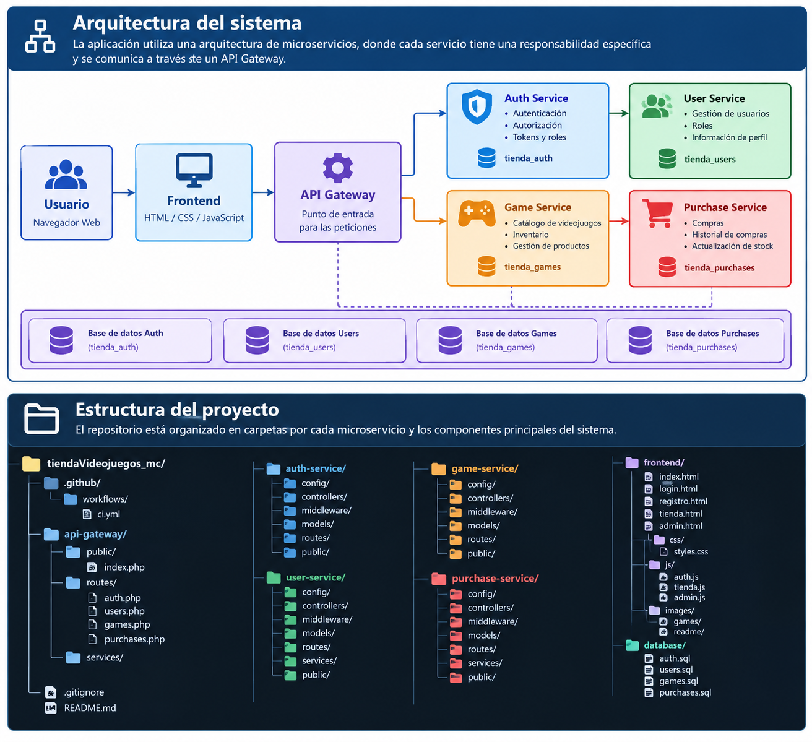

Las evidencias de ejecución y automatización incluyen:

- Interfaz de BugiStore funcionando.
- Contenedores activos mediante Docker Compose.
- Imágenes publicadas en Docker Hub.
- Ejecución exitosa de GitHub Actions.
- Pipeline Jenkins con resultado exitoso.
- Publicación de las seis imágenes mediante Jenkins.

---

# 29. Estado final del proyecto

BugiStore cuenta con los siguientes componentes y funcionalidades:

## Aplicación

- Arquitectura de microservicios.
- Auth Service.
- User Service.
- Game Service.
- Purchase Service.
- API Gateway.
- Bases de datos independientes.
- Sistema de autenticación.
- Sistema de autorización por roles.
- Catálogo de videojuegos.
- Control de inventario.
- Sistema de compras.
- Panel administrativo.
- Frontend funcional.

## PWA

- Manifest configurado.
- Service Worker funcionando.
- Caché de recursos estáticos.
- Actualización de versiones de caché.
- Instalación como aplicación.
- Disponibilidad offline de recursos previamente almacenados.

## Docker y despliegue

- Dockerfiles para los servicios PHP y frontend.
- Contenedorización de los siete componentes.
- Orquestación mediante Docker Compose.
- Red interna para comunicación entre contenedores.
- Persistencia de datos mediante volumen MySQL.
- Seis imágenes publicadas en Docker Hub.

## Automatización

- Control de versiones mediante Git y GitHub.
- Integración continua con GitHub Actions.
- Pruebas automatizadas.
- Construcción y publicación de imágenes Docker.
- Pipeline CI/CD mediante Jenkins.
- Publicación verificada de seis imágenes en Docker Hub mediante Jenkins, ejecución #21.

---

# 30. Conclusión

BugiStore cumple con el objetivo de implementar una plataforma web para la gestión y venta de videojuegos mediante una arquitectura de microservicios.

La separación de responsabilidades permite que cada servicio administre un dominio específico del sistema, mientras que el API Gateway proporciona un punto de acceso centralizado para el frontend.

La implementación de autenticación, autorización, control de inventario y gestión de compras permite cubrir las principales necesidades funcionales de la plataforma.

La incorporación de Docker y Docker Compose permite ejecutar los diferentes componentes en contenedores independientes, facilitando su administración y despliegue.

Asimismo, GitHub Actions y Jenkins permiten automatizar procesos de validación, construcción y publicación de imágenes, integrando prácticas de integración y entrega continua.

Finalmente, la implementación de una Progressive Web App amplía las capacidades del sistema al permitir su instalación como aplicación y proporcionar disponibilidad offline para los recursos estáticos previamente almacenados.

El proyecto integra desarrollo web, arquitectura de microservicios, bases de datos independientes, contenedorización, automatización CI/CD y tecnologías PWA, constituyendo una solución académica completa para la gestión y venta de videojuegos.