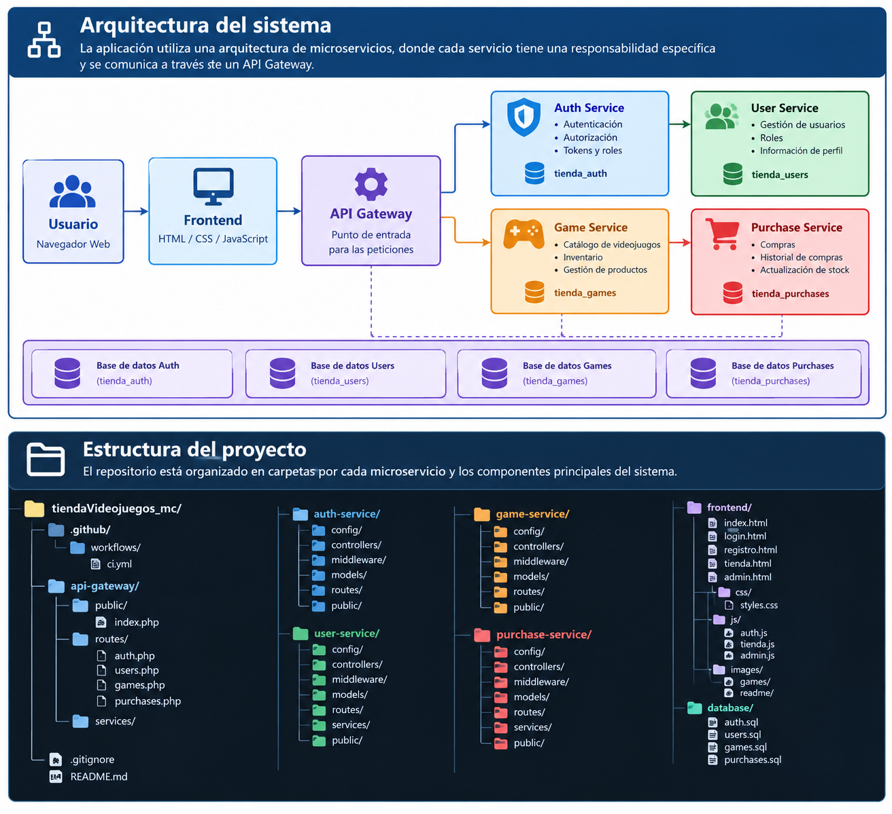
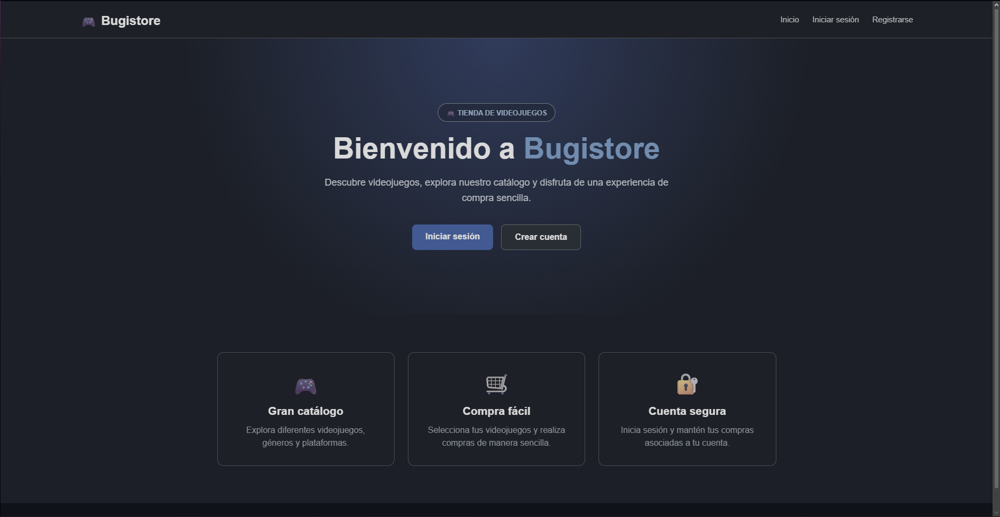
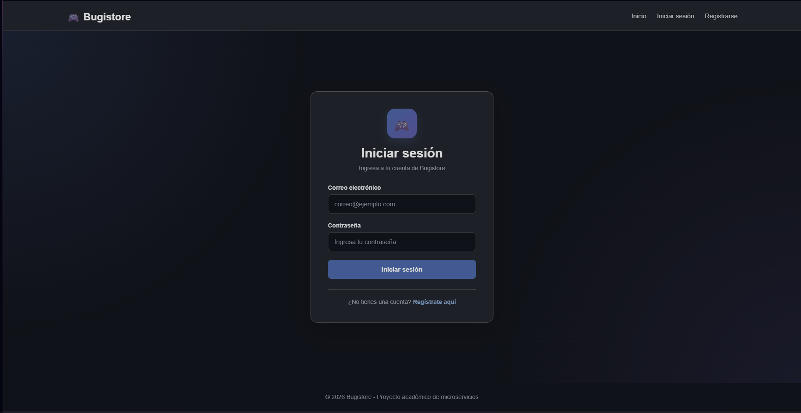
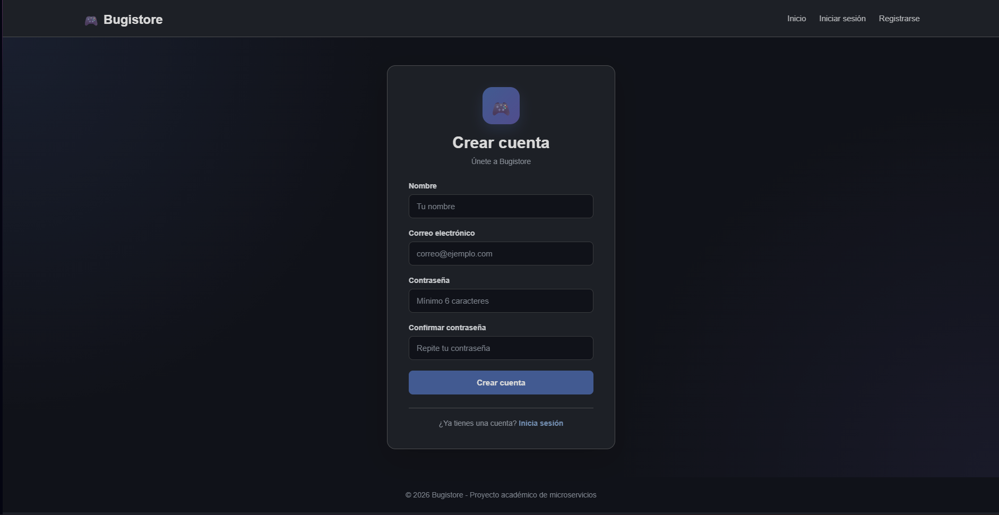
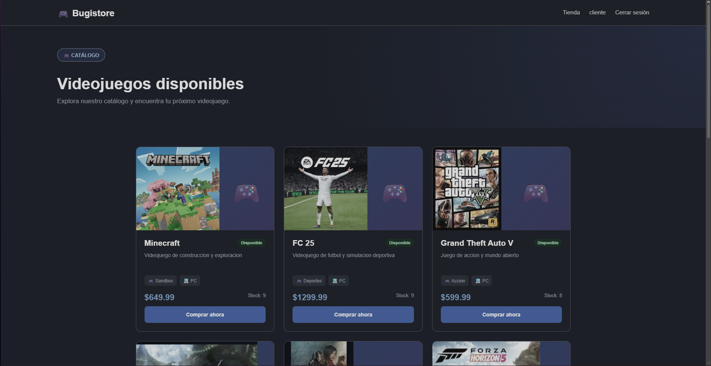
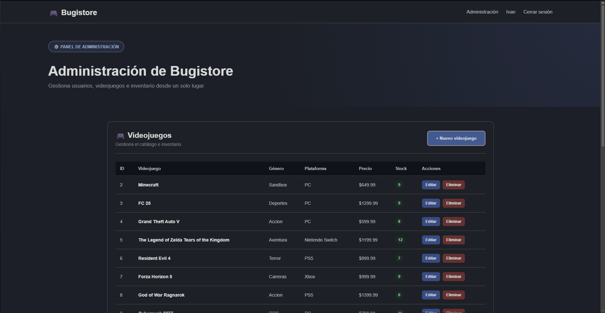

# Bugistore

## Tienda de Venta y Gestión de Videojuegos

**Bugistore** es un proyecto académico de una tienda web de videojuegos desarrollada mediante una arquitectura basada en **microservicios**.

El sistema permite gestionar usuarios, videojuegos y compras, incorporando autenticación, autorización mediante roles, administración del catálogo y procesamiento de compras.

El proyecto fue desarrollado utilizando tecnologías web tradicionales y herramientas disponibles en **AppServ**.

---

## Integrantes del equipo

| Integrante                         | Rol                         | Microservicio / Área |
| ---------------------------------- | --------------------------- | -------------------- |
| **Uscanga Lara Ivan**              | Líder de Proyecto / Backend | `auth-service`       |
| **Camacho Hernandez Donovan Emir** | Backend Developer           | `user-service`       |
| **Medina Estrada Ethan Issac**     | Backend Developer           | `game-service`       |
| **Alavez Hernandez Alan Cesar**    | Backend Developer           | `purchase-service`   |
| **Osorio Angeles Monica Lizeth**   | Backend Developer           | `purchase-service`   |

---

## Tecnologías utilizadas

### Backend

* PHP 7.3
* MySQL
* Apache
* AppServ
* Arquitectura de microservicios
* API REST
* JSON
* Bearer Token

### Frontend

* HTML5
* CSS3
* JavaScript

### Control de versiones

* Git
* GitHub
* GitHub Actions

---

## Arquitectura del sistema

Bugistore utiliza una arquitectura de microservicios en la que cada servicio tiene una responsabilidad específica.



La comunicación entre el frontend y los diferentes servicios se realiza mediante el **API Gateway**, que funciona como punto de entrada principal a la aplicación.

### Flujo general

```text
                    ┌─────────────────────┐
                    │      FRONTEND       │
                    │    HTML / CSS / JS  │
                    └──────────┬──────────┘
                               │
                               ▼
                    ┌─────────────────────┐
                    │    API GATEWAY      │
                    └──────────┬──────────┘
                               │
          ┌────────────────────┼────────────────────┐
          │                    │                    │
          ▼                    ▼                    ▼
 ┌────────────────┐   ┌────────────────┐   ┌────────────────┐
 │ AUTH SERVICE   │   │  USER SERVICE  │   │  GAME SERVICE  │
 └───────┬────────┘   └───────┬────────┘   └───────┬────────┘
         │                    │                    │
         ▼                    ▼                    ▼
 ┌────────────────┐   ┌────────────────┐   ┌────────────────┐
 │ tienda_auth    │   │ tienda_users   │   │ tienda_games   │
 └────────────────┘   └────────────────┘   └────────────────┘

                               │
                               ▼
                     ┌──────────────────┐
                     │ PURCHASE SERVICE │
                     └────────┬─────────┘
                              │
                              ▼
                     ┌──────────────────┐
                     │ tienda_purchases │
                     └──────────────────┘
```

---

## Estructura del proyecto

La estructura actual del repositorio es:


```text
-gestion-desarrollo-software-equipo01/
│
├── .github/
│   └── workflows/
│       └── ci.yml
│
├── api-gateway/
│   ├── public/
│   ├── routes/
│   └── services/
│
├── auth-service/
│   ├── controllers/
│   ├── middleware/
│   ├── models/
│   ├── public/
│   └── routes/
│
├── database/
│   ├── tienda_auth/
│   ├── tienda_games/
│   ├── tienda_purchases/
│   └── tienda_users/
│
├── frontend/
│   ├── css/
│   │   └── styles.css
│   │
│   ├── images/
│   │   ├── games/
│   │   └── README/
│   │       ├── admin.png
│   │       ├── arquitectura-estructura.png
│   │       ├── inicio.png
│   │       ├── login.png
│   │       ├── registro.png
│   │       └── tienda.png
│   │
│   ├── js/
│   │   ├── admin.js
│   │   ├── auth.js
│   │   └── tienda.js
│   │
│   ├── admin.html
│   ├── index.html
│   ├── login.html
│   ├── registro.html
│   └── tienda.html
│
├── game-service/
│   ├── controllers/
│   ├── middleware/
│   ├── models/
│   ├── public/
│   └── routes/
│
├── purchase-service/
│   ├── controllers/
│   ├── middleware/
│   ├── models/
│   ├── public/
│   └── routes/
│
├── user-service/
│   ├── controllers/
│   ├── middleware/
│   ├── models/
│   ├── public/
│   └── routes/
│
├── .gitignore
└── README.md
```

---

## Microservicios

### Auth Service

El microservicio de autenticación se encarga de:

* Registro de usuarios.
* Inicio de sesión.
* Validación de sesiones.
* Generación de tokens.
* Cierre de sesión.
* Gestión de roles.
* Autorización de usuarios administradores.
* Comunicación interna con `user-service`.

Los roles disponibles son:

```text
usuario
admin
```

---

### User Service

El microservicio de usuarios administra la información de los usuarios registrados.

Sus principales funciones son:

* Listar usuarios.
* Consultar usuarios.
* Actualizar usuarios.
* Eliminar usuarios.
* Validar permisos administrativos.
* Sincronizar información con `auth-service`.

---

### Game Service

El microservicio de videojuegos administra el catálogo de productos.

Sus funciones principales son:

* Listar videojuegos.
* Consultar videojuegos individuales.
* Crear videojuegos.
* Actualizar videojuegos.
* Eliminar videojuegos.
* Administrar existencias.
* Disminuir el stock durante una compra.

El catálogo cuenta con videojuegos y sus respectivos datos de nombre, descripción, precio, stock e imagen.

---

### Purchase Service

El microservicio de compras se encarga de procesar las compras realizadas por los usuarios.

El flujo de compra realiza las siguientes operaciones:

1. Valida la autenticación del usuario.
2. Obtiene la información del videojuego.
3. Verifica la cantidad solicitada.
4. Comprueba la disponibilidad del stock.
5. Disminuye el stock del videojuego.
6. Registra la compra.
7. Devuelve la información correspondiente al usuario.

También permite:

* Consultar el historial de compras del usuario.
* Consultar todas las compras mediante una cuenta administrativa.

---

## API Gateway

El `api-gateway` funciona como punto de entrada de las peticiones realizadas desde el frontend.

Las principales áreas disponibles son:

```text
?action=auth
?action=users
?action=games
?action=purchases
```

Esto permite centralizar el acceso a los diferentes microservicios y evitar que el frontend tenga que comunicarse directamente con cada servicio.

---

## Frontend

El frontend fue desarrollado utilizando únicamente:

* HTML
* CSS
* JavaScript

Las principales páginas de la aplicación son:

```text
index.html
login.html
registro.html
tienda.html
admin.html
```

### Página de inicio



### Inicio de sesión



### Registro



### Tienda



### Panel de administración



---

## Gestión de roles

El sistema implementa dos roles principales.

### Usuario

El usuario puede:

* Registrarse.
* Iniciar sesión.
* Consultar el catálogo.
* Comprar videojuegos.
* Consultar su historial de compras.

### Administrador

El administrador puede:

* Consultar usuarios.
* Crear usuarios.
* Editar usuarios.
* Eliminar usuarios.
* Consultar videojuegos.
* Crear videojuegos.
* Editar videojuegos.
* Eliminar videojuegos.
* Consultar las compras realizadas.

Las operaciones administrativas están protegidas mediante autenticación y autorización.

---

## Bases de datos

Cada microservicio utiliza su propia base de datos, siguiendo el principio de separación de responsabilidades.

```text
tienda_auth
    └── Información relacionada con autenticación y tokens

tienda_users
    └── Información de usuarios

tienda_games
    └── Catálogo y stock de videojuegos

tienda_purchases
    └── Registro de compras
```

Esta separación permite mantener independientes los datos correspondientes a cada dominio del sistema.

---

## Seguridad

El sistema utiliza autenticación mediante **Bearer Token**.

Las peticiones protegidas requieren enviar el token mediante el encabezado:

```text
Authorization: Bearer TOKEN
```

Las operaciones administrativas requieren además que el usuario tenga el rol:

```text
admin
```

Los usuarios con rol `usuario` no pueden acceder a las funciones administrativas.

---

## Pruebas realizadas

Durante el desarrollo se realizaron pruebas mediante terminal y navegador.

### Autenticación

* Registro de usuario.
* Inicio de sesión.
* Validación de token.
* Cierre de sesión.
* Validación de roles.

### Usuarios

* Listado.
* Consulta.
* Actualización.
* Eliminación.
* Sincronización entre servicios.

### Videojuegos

* Listado.
* Consulta.
* Creación.
* Actualización.
* Eliminación.
* Disminución de stock.

### Compras

* Creación de compra.
* Validación de stock.
* Actualización de existencias.
* Registro de compra.
* Historial del usuario.
* Consulta administrativa de compras.

### Seguridad

* Bloqueo de funciones administrativas para usuarios normales.
* Validación de tokens.
* Protección de endpoints administrativos.

---

## Instalación y ejecución

### Requisitos

Para ejecutar el proyecto localmente se requiere:

* Windows
* AppServ
* Apache
* MySQL
* PHP 7.3 o compatible
* Git

### Ubicación del proyecto

El proyecto se encuentra dentro del directorio de Apache:

```text
C:\AppServ\www\-gestion-desarrollo-software-equipo01
```

### URL base

```text
http://localhost/-gestion-desarrollo-software-equipo01/
```

### Frontend

Para acceder a la aplicación:

```text
http://localhost/-gestion-desarrollo-software-equipo01/frontend/
```

Es necesario que Apache y MySQL estén activos desde AppServ.

---

## Control de versiones

El proyecto utiliza Git y GitHub para el control de versiones y colaboración entre los integrantes del equipo.

El repositorio contiene los diferentes microservicios, frontend, configuración de base de datos y archivos de documentación.

Repositorio:

```text
https://github.com/XFaiderrrr/-gestion-desarrollo-software-equipo01
```

---

## Integración continua

El proyecto cuenta con un flujo de **GitHub Actions** ubicado en:

```text
.github/workflows/ci.yml
```

El flujo se ejecuta cuando se realizan cambios mediante:

* `push` a `main`
* `pull_request` hacia `main`

El proceso utiliza:

* Ubuntu
* PHP 7.3
* MySQL 8.0
* Extensiones `pdo` y `pdo_mysql`

Esto permite comprobar automáticamente la configuración básica del proyecto y su entorno de ejecución.

---

## Estado final del proyecto

### Funcionalidades de usuario

* [x] Registro de usuarios
* [x] Inicio de sesión
* [x] Catálogo de videojuegos
* [x] Compra de videojuegos
* [x] Descuento automático de stock
* [x] Historial de compras

### Funcionalidades administrativas

* [x] Inicio de sesión administrativo
* [x] Listado de usuarios
* [x] Creación de usuarios
* [x] Edición de usuarios
* [x] Eliminación de usuarios
* [x] Listado de videojuegos
* [x] Creación de videojuegos
* [x] Edición de videojuegos
* [x] Eliminación de videojuegos
* [x] Consulta de compras

### Seguridad

* [x] Autenticación mediante token
* [x] Validación de roles
* [x] Protección de endpoints administrativos
* [x] Bloqueo de funciones administrativas para usuarios normales
* [x] Comunicación entre microservicios

### Infraestructura

* [x] Arquitectura de microservicios
* [x] API Gateway
* [x] Bases de datos independientes
* [x] Integración con GitHub
* [x] GitHub Actions
* [x] Documentación del proyecto

---

## Objetivo del proyecto

El objetivo de Bugistore es desarrollar una aplicación web funcional para la venta y gestión de videojuegos, aplicando los principios fundamentales de una arquitectura basada en microservicios.

El proyecto permite poner en práctica conceptos relacionados con:

* Desarrollo web.
* APIs REST.
* Arquitectura de microservicios.
* Bases de datos.
* Autenticación y autorización.
* Gestión de roles.
* Comunicación entre servicios.
* Control de versiones.
* Integración continua.

---

## Conclusión

Bugistore representa una implementación funcional de una tienda de videojuegos basada en una arquitectura de microservicios.

El sistema integra autenticación, gestión de usuarios, administración de videojuegos, control de inventario y procesamiento de compras, manteniendo cada responsabilidad separada en diferentes servicios.

La implementación también incorpora un API Gateway, bases de datos independientes, control de acceso mediante roles, GitHub para el control de versiones y GitHub Actions para integración continua.

Con esto se obtiene una aplicación web funcional que cumple con los objetivos establecidos para el proyecto académico.
